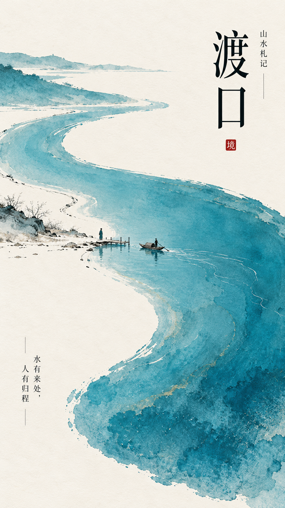
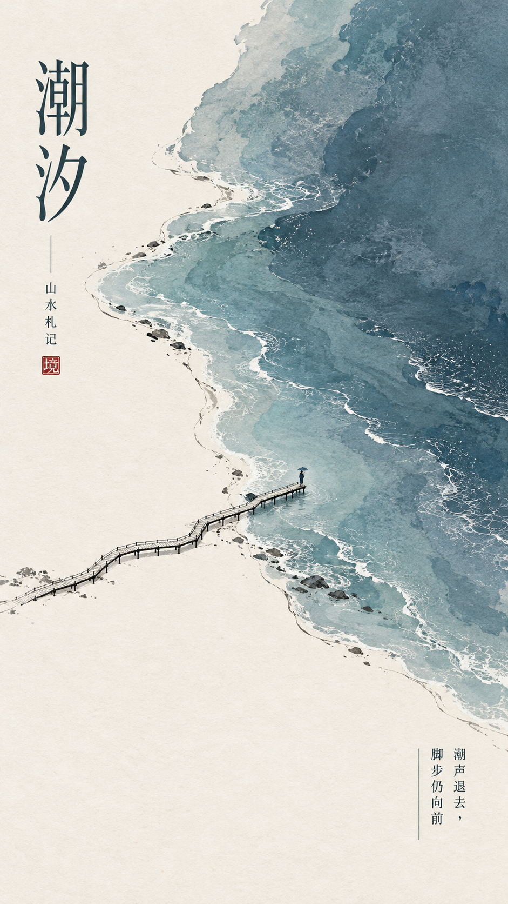
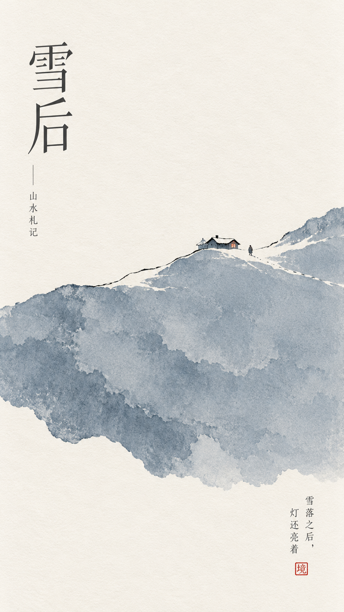
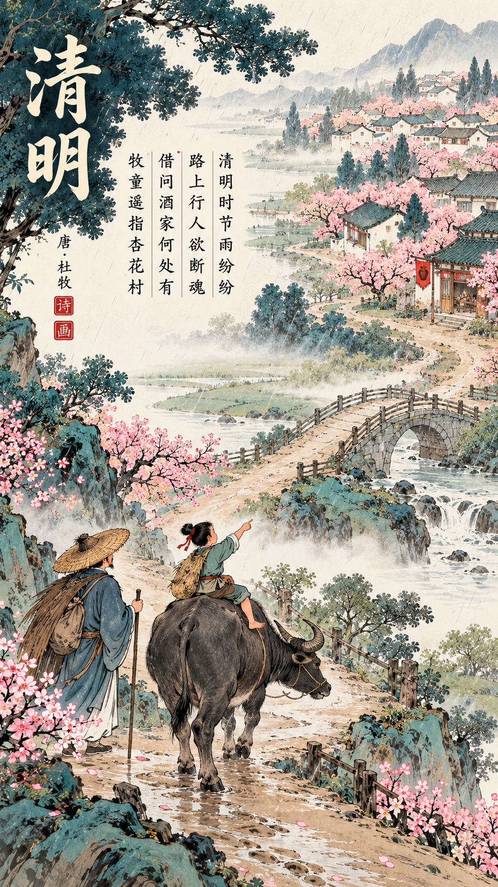
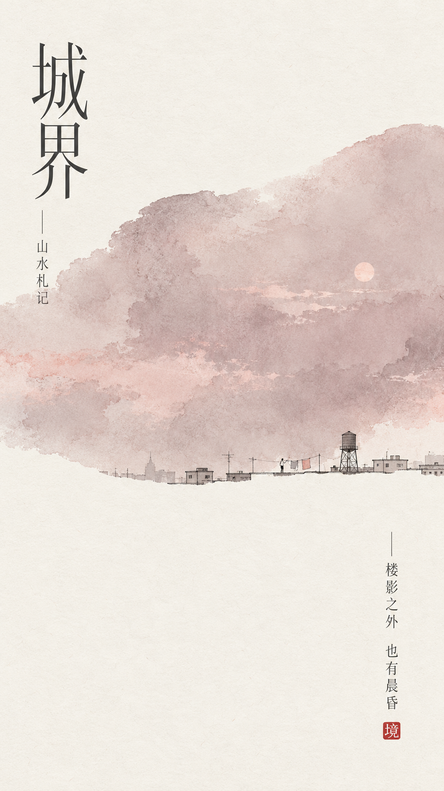
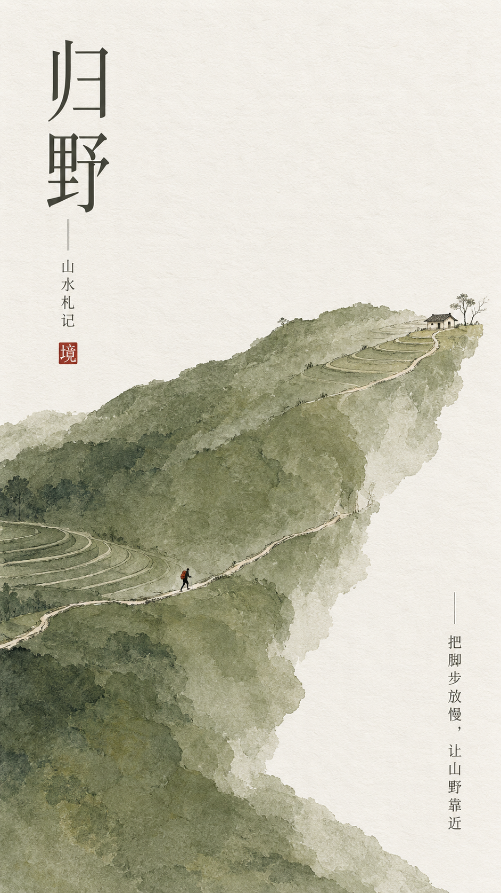
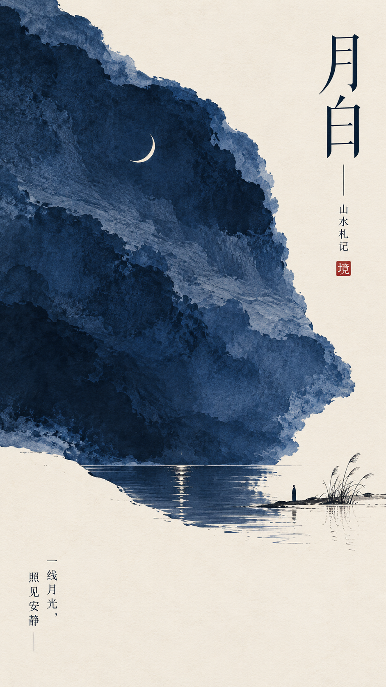
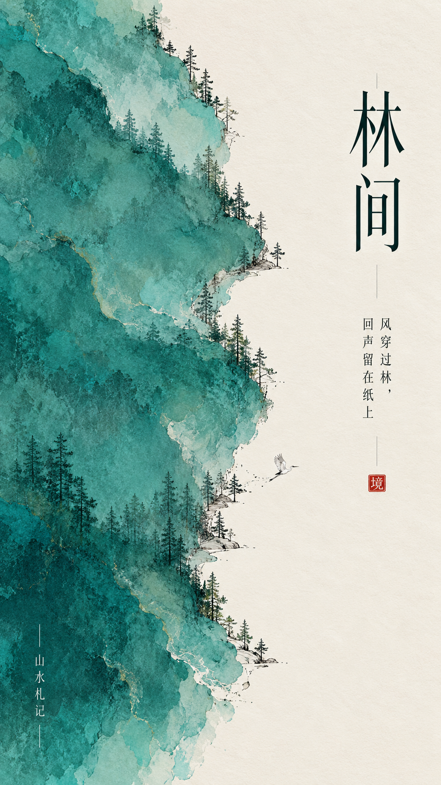

# 中式极简展览海报 Skill / Eastern Minimal Exhibition Poster Skill

融合东方山水留白、现代编辑设计、抽象色域绘画与纸艺质感，生成一张高完成度的中式极简艺术展览海报。远看极简，近看有层次。


## 作品展示 · Gallery

| | | |
|---|---|---|
|  |  |  |
|  |  |  |
|  |  |  |

## 它能做什么
- 暖象牙白艺术纸底 + 一块不规则主色域（约 40–55%），矿物颜料 / 水粉 / 丝网印刷质感
- 色域与留白交界处的极细墨线地景，配极小的微型叙事
- 竖排瘦高宋体标题、英文衬线小字、FIELD NOTES、题跋、手写注记、朱砂小印
- 只给主题也能用：其余字段自动协调补全
- 每个主题重新设计构图，不是换色模板

## 安装
**作为 Agent Skill（Claude Code / Cursor / Codex 等）**：

```bash
git clone https://github.com/ericchan916/eastern-minimal-exhibition-poster-skill.git
cp -r eastern-minimal-exhibition-poster-skill ~/.claude/skills/eastern-minimal-exhibition-poster
# 或 ~/.cursor/skills/、~/.codex/skills/ 等
```

**在 ChatGPT / 其他图像模型中使用**：复制 [`prompt.md`](prompt.md) 里的完整提示词，填入字段即可。

## 使用示例
```
【主题】：潮汐笔记
【主色域】：灰青蓝，从右上斜向左下流动
【地景】：极细的海岸线与一段木栈道
【微型叙事】：一个撑伞的人走在栈道尽头
【中文题跋】：潮来潮去，皆是归途
【画幅】：9:16
```
或只写：`【主题】：雪后`

更多示例见 [`examples/themes.md`](examples/themes.md)。

## 画面结构
| 元素 | 规则 |
|---|---|
| 背景 | 干净暖象牙白艺术纸 |
| 主色域 | 不规则，约 40–55%，干净的纸艺/颜料质感 |
| 地景 | 极细墨黑线，位于色域与留白交界 |
| 微型叙事 | 极小人物/建筑，制造尺度反差 |
| 文字 | 竖排宋体/明朝主标题、英文衬线、日期、题跋、手写注记 |
| 点睛 | 一枚极小朱砂红印章 |

## English
**Eastern Minimal Exhibition Poster** generates one refined Chinese minimalist art-exhibition poster: an irregular color field on ivory art paper, a hairline ink landscape, a tiny narrative, vertical Song-style title and a cinnabar seal. Copy the folder into your agent's skills directory, or paste `prompt.md` into ChatGPT or any image model.

## License
MIT © 2026 Joy Robinson — 见 [LICENSE](LICENSE)。生成图片的使用请同时遵守你所用图像模型的服务条款。
